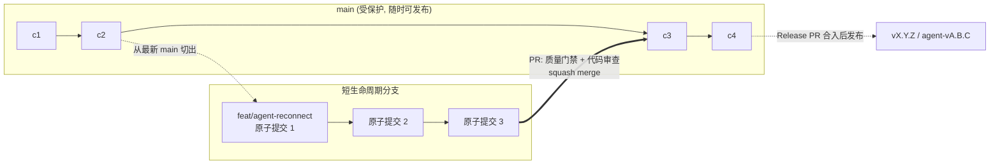

# Git 版本管理规范 (Git Workflow)

本文档定义 **RiriCloud** 的分支模型、提交信息规范与合并策略。版本号递增与发布 Tag 规则见 [VERSIONING.md](./VERSIONING.md)，本文不重复。

---

## 1. 分支模型：GitHub Flow

采用轻量的 GitHub Flow——**`main` 是唯一长期分支，任何时候都保持可发布状态**：



| 规则 | 说明 |
| :--- | :--- |
| **main 绝对受保护** | 禁止直接 push、禁止 force push、禁止直接 commit、禁止删除；唯一合法合入方式为 PR Squash Merge |
| **本地 Hook 物理阻断** | `.husky/pre-commit` 与 `.husky/pre-push` 自动检测并物理阻断在 main/master 分支上的提交与推送，严禁使用 `--no-verify` 绕过 |
| **短生命周期** | 功能分支存活以「天」为单位，合入即删；长期不合并的分支须定期 rebase main 解决漂移 |
| **随时可发布** | main 上每个提交都必须通过质量门禁（见 [CODE_REVIEW.md](./CODE_REVIEW.md) §2），不引入半成品特性 |
| **未完成功能** | 通过功能开关或按模块渐进合入，而不是长期挂分支 |

> 本项目采用 GitHub Flow，不维护 Git Flow 的长期 develop/release 分支。发版使用短生命周期 `release/vX.Y.Z`（Master）或 `release/agent-vA.B.C`（Agent）分支，完成对应 bump 后通过 Release PR 合入；随后从干净、已同步的 main 发布对应 Tag。日常 PR 不递增版本（见 [VERSIONING.md](./VERSIONING.md) §6）。

---

## 2. 分支命名

格式：`<type>/<scope>-<简短描述>`，描述用小写英文与短横线，总长控制在 40 字符内。

| type | 用途 | 示例 |
| :--- | :--- | :--- |
| `feat` | 新功能 | `feat/server-sub-engine` |
| `fix` | 缺陷修复 | `fix/agent-ws-reconnect` |
| `docs` | 文档 | `docs/code-review-spec` |
| `refactor` | 重构 | `refactor/prisma-service` |
| `chore` | 构建/工具/依赖 | `chore/husky-commitlint` |
| `release` | 短生命周期发版 PR（命名特例） | `release/vX.Y.Z` / `release/agent-vA.B.C` |

`scope` 从 [§3.2](#32-scope-作用域枚举) 的枚举中选取。单人开发也必须遵守命名与提交规范——规范的价值在于让 AI 代理与历史工具（bisect、revert、changelog 生成）始终可依赖。

---

## 3. 提交信息规范 (Conventional Commits)

遵循 [Conventional Commits 1.0.0](https://www.conventionalcommits.org/zh-hans/v1.0.0/)，**type 用英文枚举，描述用中文**。

### 3.1 格式

```
<type>(<scope>): <中文描述>

[可选正文：动机与实现要点，中文]

[可选 footer]
```

- **标题行**不超过 50 个字符（中文按 1 字符计），结尾不加句号。
- 正文说明「为什么」，不重复 diff 能看出的「是什么」。

```text
feat(server): 实现多格式订阅生成引擎

按 User-Agent 与 ?type 参数自动适配 Clash Meta / Sing-box /
Base64 输出，并附带 Subscription-Userinfo 响应头。

Closes #12
```

### 3.2 scope 作用域枚举

| scope | 覆盖范围 |
| :--- | :--- |
| `web` | `apps/web` 前端 |
| `server` | `apps/server` 主控后端 |
| `agent` | `apps/agent` Go 边缘节点守护程序 |
| `db` | Prisma schema、迁移与数据层 |
| `proto` | Master-Agent WS 协议、订阅 URL 契约（跨端联动变更优先用此 scope） |
| `docs` | 文档库 |
| `repo` | 工程配置、CI、构建脚本、依赖升级 |
| （省略） | 仅当确属跨域杂项时才允许省略 scope |

### 3.3 type 枚举

`feat` / `fix` / `docs` / `refactor` / `perf` / `test` / `build` / `ci` / `chore` / `revert`

- CHANGELOG 按变更效果选择 `Added` / `Changed` / `Fixed` / `Removed` / `Security` / `Deprecated`，不只收录 `feat` 和 `fix`。核心路径变更须维护对应 `[Unreleased]`，门禁按文件路径判定，不因 `refactor` / `test` / `docs` 等 type 自动豁免；纯非核心文档或脚本变更不强制发版。
- `chore` 与 `docs` 的区分：改 `docs/` 目录一律 `docs`，改根级工程文件（lint 配置、CI、Dockerfile）一律 `chore(repo)`。

### 3.4 破坏性变更

标题 type 后加 `!`，并在 footer 写明破坏点与迁移方式：

```text
feat(proto)!: 心跳消息增加必填 uptimeMs 字段

BREAKING CHANGE: heartbeat.data 缺失 uptimeMs 的旧 Agent 将被
Master 拒绝。Agent 侧需同步升级到本版本。
```

破坏性变更对应的版本位判定见 [VERSIONING.md](./VERSIONING.md) §2。

### 3.5 原子提交

- 一个提交只做一件事：功能、其配套测试、其文档更新放在**同一个提交**内。
- 禁止"顺手"混入无关格式化或重构；重构与功能严禁同一个提交（便于 revert 与 review）。
- 提交前自查 `git diff --staged`，确保暂存内容与提交信息相符。

---

## 4. 合并与发布操作

| 环节 | 约定 |
| :--- | :--- |
| **合并方式** | 统一 **squash merge**：分支上的多个原子提交压成 main 上的一个提交，提交信息取 PR 标题——因此 PR 标题必须符合 [§3](#3-提交信息规范-conventional-commits) 的格式（PR 标题不规范 = 合并产物不规范） |
| **版本与日志要求** | Master（根 `package.json`）与 Agent（`apps/agent/VERSION`）独立；日常 PR 分别维护根 `CHANGELOG.md` / `apps/agent/CHANGELOG.md` 的 `[Unreleased]`，版本保持不变。Release PR 才执行 `pnpm bump` / `pnpm bump:agent`；`pnpm gate:version` 校验对应轨道 |
| **合并前门禁** | 六类基础门禁（`gate:version` + `gate:docs` + `gate:i18n` + `gate:server` + `gate:web` + `gate:agent`）与脚本回归（`pnpm test:scripts`）组成 `pnpm gate`；另须通过适用的 CI 检查，详见 [CODE_REVIEW.md](./CODE_REVIEW.md) §2 |
| **冲突处理** | 在功能分支上 `git merge main`（或 rebase 后强推功能分支——仅功能分支允许 force push） |
| **发布** | Release PR 合入后，从干净且与 origin/main 同步的 main 执行 `pnpm release:master` / `pnpm release:agent`，脚本按对应版本源与日志构建并发布 Tag/Release，不在 main 修改、提交或推送代码；同时发两端时先 Agent 后 Master（见 [VERSIONING.md](./VERSIONING.md) §6） |

---

## 5. 禁止事项清单（零容忍红线）

1. **严禁在 `main` / `master` 分支直接提交（commit）代码**：动代码前必须先切出特性分支。
2. **严禁直接向 `main` / `master` 分支执行 push 或 force push**：所有变更必须经 PR 由 GitHub Actions 门禁验证后合并。
3. **严禁修改核心代码却未维护更新日志**：修改 `apps/server`、`apps/web` 或 `prisma` 时维护根 `CHANGELOG.md`；修改 `apps/agent` 时维护 `apps/agent/CHANGELOG.md` 的 `[Unreleased]`。跨端 PR 两处均维护，具体路径判定见 [VERSIONING.md](./VERSIONING.md) §6.1。
4. **严禁使用 `--no-verify`** 绕过本地 Husky 的 `pre-commit` 与 `pre-push` 安全检查。
5. 禁止在提交信息或 diff 中携带任何密钥、Token、证书私钥（含 `.env` 实文件——`.env.example` 除外）。
6. 禁止合并非绿 CI 的 PR；紧急回滚场景先 `revert` 再修复，不在 main 上"补丁式"直接修改。
7. 禁止一版多义：一个提交同时含 `feat` 与 `fix` 时拆分提交。

