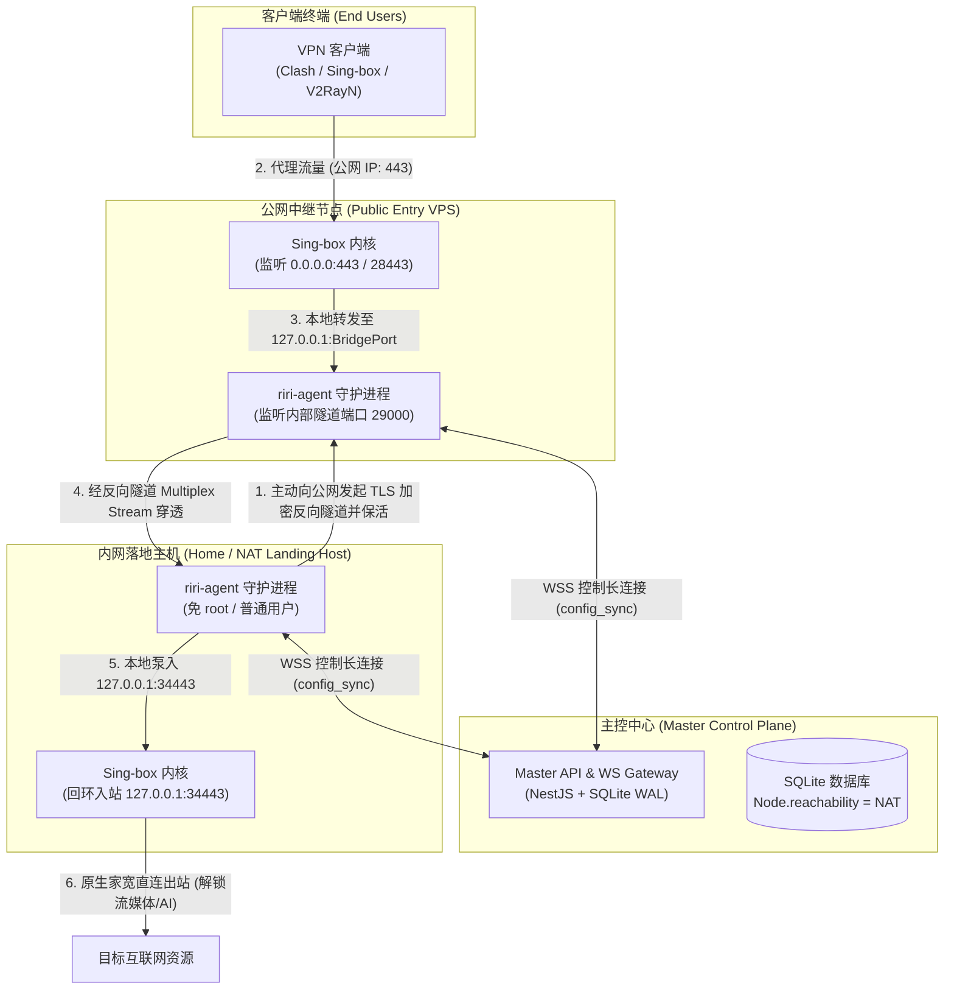
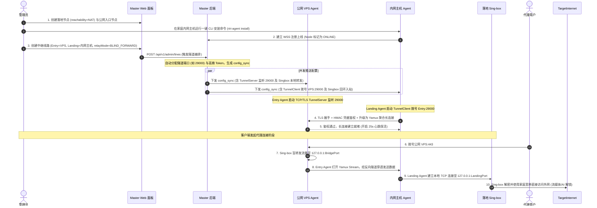

# 无公网 IP 主机（NAT/家宽）作为落地节点与反向穿透隧道全链路实现方案

## 2026-11-17 收尾复核与归档边界

本轮仅整理代码与已有测试证据，不部署生产、不实现 WireGuard。原 34/36 的两项未来工作（5.2、5.3）已原号迁移至 [WireGuard 未来扩展](./nat-wireguard-future.md)，没有将它们标成已实现。

TCP/TLS Yamux 主链路、节点对隧道编排和本地回环联调已有实现；但复核发现部分旧勾选超出代码及测试所能证明的范围，已退回待办。特别是隧道密文存储、HMAC/服务端身份校验、真实重连与资源指标不能由旧进度数字证明。本计划因此仅为**有条件归档候选**，主代理补齐下面证据差异后才能运行归档命令，不能仅因拆出 WireGuard 就直接归档。

## 🎯 1. 目标与背景 (Goals & Background)

### 1.1 业务价值与核心痛点
在代理与 VPN 服务生态中，**原生家庭宽带（Residential IP / 家宽）** 可作为经授权的落地出口：
- **流媒体与 AI 服务解锁**：Netflix、Disney+、Hulu、ChatGPT、Claude 等平台的可达性依赖出口和目标站点策略，本计划不承诺解锁比例或绕过风控。
- **防止封控与真人行为拟合**：用于爬虫、跨境电商、远程办公等场景，家宽网络具备天然抗风控优势。

**规划创建时的痛点**：部分家用宽带（电信/联通/移动）以及家庭 NAS（群晖/TrueNAS/Unraid）、软路由、家庭 PC 均处于多层运营商 NAT（CGNAT）后方，**没有公网 IPv4 地址**，外部网络无法直接发起 TCP/UDP 入站连接。当时的 RiriCloud 接入表单要求节点配置外网可达的 `serverHost`，导致无公网 IP 的主机完全无法作为节点纳管和提供中继落地。

### 1.2 架构愿景
在完全继承 RiriCloud **「零外部服务依赖红线」** 与 **「控制平面与数据平面解耦」** 的前提下，实现一套高可用、跨平台、全自动编排的**反向穿透隧道系统**：
1. **控制面无缝纳管**：由于 RiriCloud Agent 原生采用主动向 Master 发起 WSS/HTTP 连接的机制，内网主机无需任何公网 IP 即可正常接入 Master，享受心跳遥测、配置下发、一键升级与监控。
2. **数据面反向穿透**：由内网主机（落地节点）主动向公网中继 VPS 发起加密反向长连接隧道；外部客户端连接公网 VPS 入口，流量通过隧道多路复用穿透到内网主机出站，盘活家宽原生 IP。
3. **零运维与全自动编排**：管理员在 Web 控制台创建线路时，主控自动分配隧道端口、生成高熵密钥并编排路由规则；Agent 已有断网指数退避重连机制，PPPoE 动态 IP 重拨恢复速度仍须实测。

### 1.3 核心设计决策对齐 (Architecture Alignments)
- **业务定位**：专注于**落地出口节点（Egress / Landing Node）**，外部流量经公网 VPS 中继进入内网主机出站。
- **当前穿透技术**：Agent 内置 Go 原生 TCP/TLS Yamux 反向多路复用隧道，不依赖 root/TUN；WireGuard 仅保留于独立未来计划，当前不宣称支持。TCP 链路仍受实际带宽及网络策略影响。
- **拓扑组织**：**节点间聚合单隧道（Node-to-Node Aggregated Mux）**。同一对 `(公网 VPS, 内网主机)` 之间仅维持一条物理底层加密长连接，内部通过虚拟 Stream 多路复用各条 Line 流量。
- **数据建模**：`Node` 实体扩展 `reachability: "PUBLIC" | "NAT"`；`Line` 实体扩展 `allowLanAccess`（默认拦截私网 IP，保护家庭局域网安全）与隧道编排参数。
- **零依赖合规**：纯 Go 原生标准库 + 轻量 Yamux 依赖，零 CGO，零额外二进制，保留 Agent 常驻内存 ≤ 30MB 的验收预算和既有 SQLite 部署约束；本轮没有资源实测，业务/观测双库沿现行架构运行。

---

## 🏛️ 2. 详细架构设计与协议时序

### 2.1 整体网络拓扑架构

### 2.2 控制面与数据面协同交互时序

---

## 📋 3. 里程碑与全量任务分解清单 (Milestones & Actionable TODOs)

### 里程碑 1：数据模型扩展与数据库迁移 (`apps/server`)
- [x] 任务 1.1: 在 `schema.prisma` 中对 `Node` 增加 `reachability String @default("PUBLIC")` 字段（取值枚举：`PUBLIC`、`NAT`）
- [ ] 任务 1.2: 在 `schema.prisma` 中对 `Line` 增加反向穿透与安全字段：
  - `allowLanAccess Boolean @default(false)`（出站是否允许访问局域网私网 IP，默认拦截）
  - `tunnelType String?`（当前实现为 `TCP_MUX`，`WIREGUARD` 不代表已支持）
  - `tunnelPort Int?`（入口端监听的穿透服务端口）
  - `tunnelSecret String?`（字段已存在；AES-GCM 加密存储尚未获得实现证据。当前 `LinesService` 直接生成/保存 Token，网关直接读取下发，不能以 schema 注释作为完成证明）
- [x] 任务 1.3: 追加迁移 `20260912205437_add_nat_reachability_and_tunnel_fields` 已存在；本轮只读核对迁移与默认值，未对任何现有数据库执行迁移
- [x] 任务 1.4: 编写种子数据与历史兼容逻辑（既有历史 Node 默认全部归类为 `PUBLIC`，保证平滑升级）
- [x] 任务 1.5: 按照文档门禁规范同步更新 `docs/DATA_MODELS.md`

### 里程碑 2：Agent 边缘端反向隧道引擎实现 (`apps/agent`)
- [x] 任务 2.1: 依赖评估与引入：在 `apps/agent/go.mod` 引入 `github.com/hashicorp/yamux`（采用 `CGO_ENABLED=0`、无外部系统依赖；内存预算另见未完成资源验收）
- [ ] 任务 2.2: 隧道协议与消息头规范定义 (`apps/agent/internal/tunnel/config.go`)：
  - 已实现魔数 `RIRI_TUNNEL` 与独立 `version=1` 字段
  - 当前握手使用 Token、tunnelId 和 ±5 分钟时间窗；原设计的 HMAC-SHA256/严格防重放未实现。`tls.go` 客户端仍设置 `InsecureSkipVerify: true`，不能宣称服务端身份已验证；待主代理处理安全差异并补负例
- [x] 任务 2.3: 穿透服务端实现 (`apps/agent/internal/tunnel/server.go`)：
  - 监听指定 TCP/TLS 端口（`tunnelPort`）
  - 支持多 Client 连接鉴权与聚合会话维持
  - 本地 Bridge 监听器（`127.0.0.1:BridgePort`），有流量进入时打开对应 Yamux Stream 转发
- [x] 任务 2.4: 穿透客户端实现 (`apps/agent/internal/tunnel/client.go`)：
  - 主动向公网 VPS 建立 TLS 长连接并完成鉴权
  - 启动 Yamux Session 并监听新入流（`AcceptStream`）
  - 收到流后建立本地 TCP 连接至 Sing-box 目标入站端口（`127.0.0.1:LandingPort`），实现双向零拷贝数据泵（`io.Copy`）
- [x] 任务 2.5: 自愈与重连状态机 (`apps/agent/internal/tunnel/client.go` 中 supervise)
  - 实现心跳探测机制（基于 Yamux Ping，保活间隔 25 秒；连接/握手预算 10 秒，不将其称为独立 Ping 超时）
  - 实现指数退避断线重连（1s → 2s → 4s ... 最大 30s），恢复路径已实现；真实 PPPoE 重拨时延尚无验收证据
- [x] 任务 2.6: Agent 生命周期集成：在 `apps/agent/internal/runner/runner.go` 与 `ws`/`poll` 中挂接 Tunnel 实例的启动、配置重载与平滑关闭
- [x] 任务 2.7: 编写 Agent 隧道单元测试与双端 Mock 联调集成测试 (`apps/agent/internal/tunnel/tunnel_test.go`)

### 里程碑 3：Master 主控端配置生成与网关协同 (`apps/server`)
- [x] 任务 3.1: 隧道凭据与端口编排服务 (`apps/server/src/lines/tunnel-orchestrator.service.ts` 或内聚于 `lines.service.ts`)：
  - 在创建或更新包含 NAT 落地节点的中继线路时，自动为 `(entryNodeId, landingNodeId)` 节点对分配可用隧道端口与高熵 `tunnelSecret`
  - 确保同一对节点复用同一个聚合隧道（Node-to-Node Aggregated Mux）
- [x] 任务 3.2: 扩展 `AgentMessage` 协议契约与 DTO (`apps/server/src/agent-gateway/agent-message.ts`)：
  - 扩展 `config_sync` payload，增加可选的 `tunnelConfigs` 结构体（包含 `role: "SERVER" | "CLIENT"`, `listenPort`, `targetHost`, `secret`, `mappings`）
- [x] 任务 3.3: 增强 `AgentGatewayService.buildConfigSync` (`apps/server/src/agent-gateway/agent-gateway.service.ts`)：
  - 对公网入口节点：下发 TunnelServer 监听配置与 Sing-box 针对 BridgePort 的转发配置
  - 对内网落地节点：下发 TunnelClient 拨号配置，并将 Sing-box 入站配置为仅监听 `127.0.0.1:LandingPort`（禁止暴露公网）
- [x] 任务 3.4: 落地端安全拦截规则编排：
  - 当 `Line.allowLanAccess === false` 时，自动在落地节点的 Sing-box `route.rules` 顶部注入私有网段拦截规则（`geoip:private` 或 `10.0.0.0/8`、`172.16.0.0/12`、`192.168.0.0/16` 目标走 `reject` / `block`），防止外部翻墙用户窥探家庭局域网
  - 当 `Line.allowLanAccess === true` 时，允许直接出站
- [x] 任务 3.5: 节点与线路语义业务校验增强 (`apps/server/src/nodes/nodes.service.ts`、`apps/server/src/lines/lines.service.ts`)：
  - 阻止将 `reachability: NAT` 的节点创建为直连公开线路（`DIRECT`）的入口节点
  - 阻止将 `reachability: NAT` 的节点作为中继线路的入口节点
  - 仅允许将 `reachability: NAT` 的节点作为中继线路的落地节点（`landingNode`）
- [x] 任务 3.6: 服务端单元测试覆盖（配置组装、安全规则生成、节点/线路业务校验）

### 里程碑 4：前端 Web 管理界面与交互体验 (`apps/web`)
- [ ] 任务 4.1: 节点管理列表页 (`apps/web/src/pages/admin/nodes/index.tsx`)：
  - 新增「NAT / 家宽」语义徽标（与「公网 VPS」清晰区隔）
  - 当前只有 NAT 徽标及静态穿透说明；未见独立隧道运行态字段或实时就绪证明。原“实时反向隧道连通状态”需求不能算已完成
- [x] 任务 4.2: 节点创建/编辑表单模态框 (`apps/web/src/pages/admin/nodes/components/node-form-dialog.tsx`)：
  - 增加「网络可达性」单选组（公网 VPS / 内网 NAT 主机）
  - 选择 NAT 节点时，自动隐藏外网主机 IP 必填校验，提示「此主机无公网 IP，将通过反向隧道作为落地中继」
- [ ] 任务 4.3: 线路创建与编辑向导 (`apps/web/src/pages/admin/lines/`)：
  - 过滤与引导：若选择 NAT 节点，强制锁定线路类型为「中继线路 (RELAY)」且仅能作为落地节点
  - 新增安全开关：「允许访问落地端局域网资源」（附带气泡提示：默认关闭，仅允许访问公网目标，开启后可访问内网设备）
  - 隧道高级设置展示：现有表单包含参数和提示，需随 1.2 核对返回值脱敏，不能把展示明文 Token 记为“展示加密密钥”完成项
- [x] 任务 4.4: 已使用 shadcn/ui 并维护 `docs/VISUAL_VERIFICATION.md` 的 UI-05/06/09/24 索引；本轮不执行视觉验证，不以索引更新冒充视觉通过

### 里程碑 5：首发范围与未来演进分界
- [x] 任务 5.1: 穿透方案技术定型与架构对齐（明确首发主推原生零系统依赖、免 TUN/root 特权的 TCP/TLS Yamux 反向多路复用隧道；WireGuard 轨道作为未来跨主机虚拟局域网进阶演进方案）

原任务 5.2（WireGuard 拓扑生成器）和 5.3（Endpoint/路由适配）已转入 [nat-wireguard-future.md](./nat-wireguard-future.md)，均仍未完成。这里只记录转移关系，不重复计入本主线。

### 里程碑 6：端到端集成测试、文档治理与质量门禁全绿
- [x] 任务 6.1: 搭建本地/模拟 NAT 环境端到端测试：双端 Mock 联调集成测试覆盖 TCP 代理与 Yamux 多路复用流式穿透 (`internal/tunnel/tunnel_test.go`)
- [ ] 任务 6.2: 补异常故障自愈证据：当前 `tunnel_test.go` 只有单次回环往返、配置校验、ID 匹配，未直接覆盖断线重连、退避和重拨恢复
- [ ] 任务 6.3: 默认私网阻断已由 `agent-gateway.service.spec.ts` 的 NAT 配置断言覆盖；补 `allowLanAccess=true` 放行及实际内核访问的证据。原引用 `agent-gateway.sqlite.spec.ts` 实为账务测试，不能替代安全隔离验收
- [x] 任务 6.4: 同步更新文档库（`docs/DATA_MODELS.md`、`docs/TECH_STACK.md`、`docs/API_AND_PROTOCOLS.md`、`docs/VISUAL_VERIFICATION.md`）
- [x] 任务 6.5: 在 `CHANGELOG.md` 与 `apps/agent/CHANGELOG.md` 顶部的 `[Unreleased]` 维护规范条目
- [x] 任务 6.6: 历史版本门禁记录保留；当前 `pnpm gate` 已为六类基础门禁加脚本回归，当前合并门禁另行复跑，不沿用历史完成勾

---

## 🧪 4. 验收标准与测试记录

- [x] **数据模型与迁移**：Prisma 迁移顺利执行，历史数据无缝升级，`pnpm gate:server` 通过。
- [ ] **Agent 隧道稳定性**：补多并发长连接、取消后的 goroutine 退出与 ≤30MB 内存测量；单次 Echo 测试和代码中 `Close()` 不能证明这些指标。
- [ ] **网络自愈验收**：重连状态机已有实现，真实中断、重连、重拨的观测及清理证据仍缺失（对应 6.2）。
- [ ] **局域网安全验收**：已证实默认阻断配置生成；实际内核拒绝/显式放通成对测试仍待补齐（对应 6.3）。
- [x] **本轮本地集成门禁**：`artifacts/verification/gate-submission.log` 记录完整 `pnpm gate` 退出 0（主代理确认），六类基础门禁、脚本及维护回归通过；工具链提交 `f982646`，其余集成尚未提交，最终提交绑定及远程 CI 仍待完成。

## 5. 当前证据映射与归档交接

| 范围 | 可复核证据 | 能证明与不能证明的内容 |
| :--- | :--- | :--- |
| 模型/拓扑 | `schema.prisma`、追加 NAT migration、`LinesService` NAT 节点对编排 | PUBLIC 默认值、端口/Token 复用、NAT 只作落地；密文存储差异见 1.2 |
| 数据面主链路 | `apps/agent/internal/tunnel/tunnel_test.go`；`artifacts/verification/gate-submission.log` 中 tunnel 包为 `ok (cached)` | 回环 Echo/配置/ID 校验通过（本次缓存命中）；不证明高负载、真实 NAT 或重拨 |
| Master 配置 | `agent-gateway.service.spec.ts` NAT 用例；`artifacts/verification/gate-submission.log` 中此套件 PASS | 入口回环桥接、落地回环监听、默认私网阻断和 TunnelConfigs；对应 Server 套件及完整本地 gate 已通过；不证明实际 NAT/局域网内核验收 |
| 前端 | 节点列表/表单与线路 NAT 卡片、UI-05/06/09/24 | 静态拓扑说明和操作入口；不证明独立隧道实时状态或视觉验收 |

最新 `artifacts/verification/gate-submission.log` 为本轮完整本地 gate 成功日志：Server 124 套件/1597 项通过，11 套件/105 项 native 跳过；Web 144 项、脚本 106 项、维护 33 项通过，脚本另 4 项默认跳过，Agent 门禁通过。旧 discovery/E2E storage 失败已被成功复跑取代。此结果不补齐本计划的稳定性、重拨、局域网安全、资源测量或生产证据；相关未完成项继续保留。

归档条件：解决 1.2、2.2、4.1、4.3 与测试证据缺口，完成当前门禁后，由主代理执行 `pnpm plan:archive nat-landing-node-reverse-tunnel.md`。本次不执行归档、不改总计划或索引；生产部署仍不在本轮授权内。
